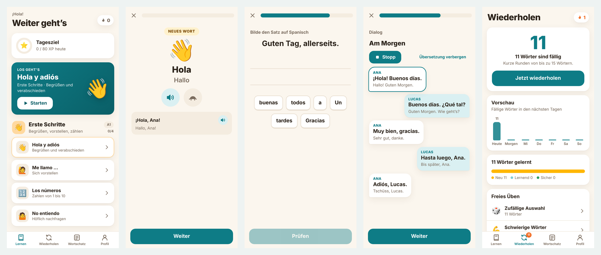
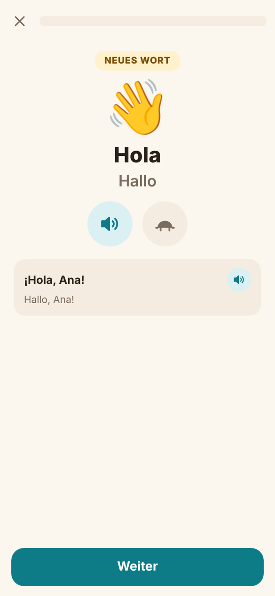
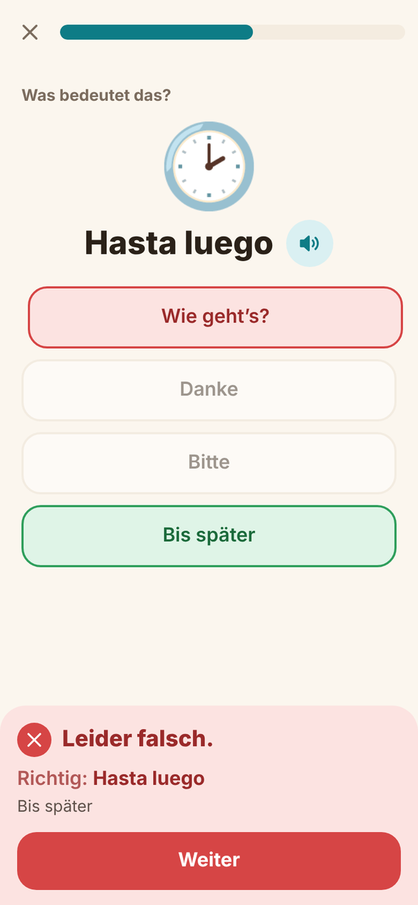
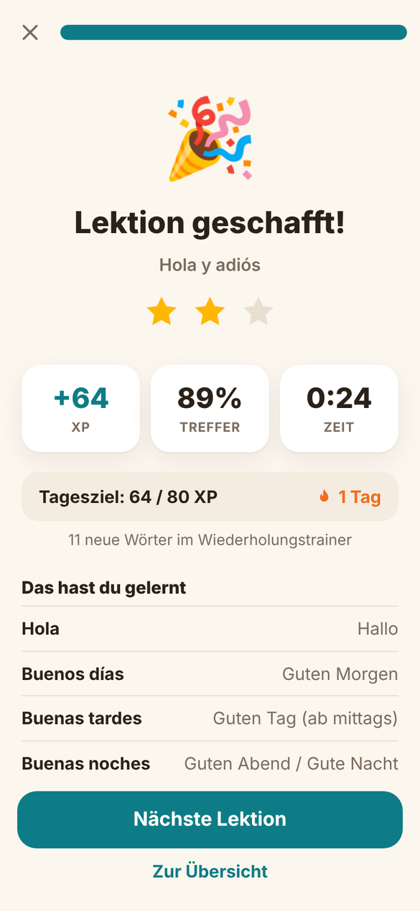
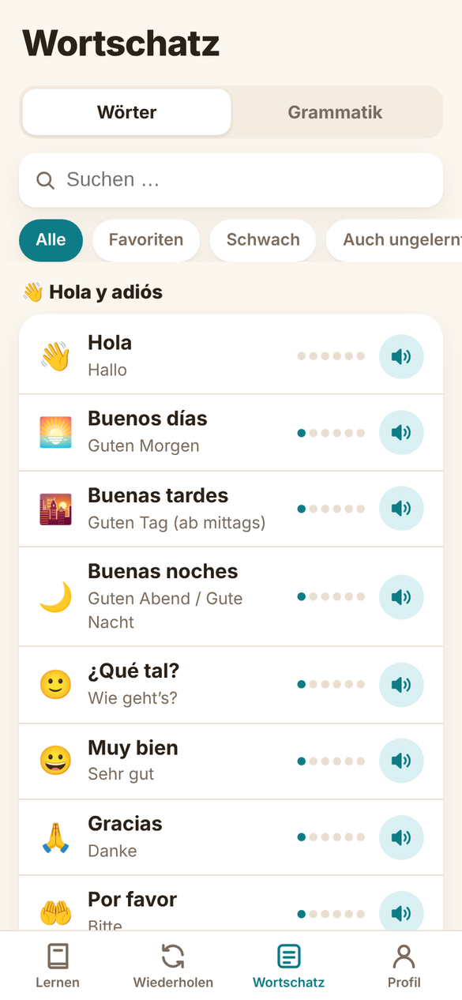
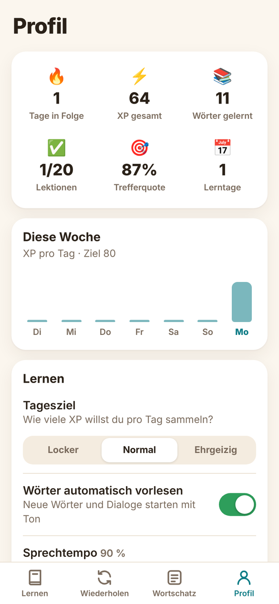

# Charla – Spanisch lernen für iOS

[English](README.md) · **Deutsch**

[](../../actions/workflows/ci.yml)
[](LICENSE)

Charla ist eine kostenlose, quelloffene Lern-App für Spanisch (Niveau A1) mit deutscher oder englischer Oberfläche (Sprache wählbar). Sie läuft offline auf dem iPhone und im Browser, braucht keine Konten und keine fremden Bibliotheken.



> **Dieses Projekt ist mit KI entstanden.** Code, Lerninhalte, Texte und App-Icon wurden zusammen mit Claude (Anthropic) entwickelt. Die Spanisch-Inhalte wurden automatisch und stichprobenartig geprüft, aber nicht von einer Lehrkraft. Fehler sind möglich. Du kannst sie über die Issue-Vorlage „Fehler im Lerninhalt“ melden. Charla hat keine Verbindung zu kommerziellen Sprachlern-Diensten.

## Funktionen

- **Lektionen:** 5 Einheiten, 20 Lektionen, rund 220 Wörter und Sätze. Jede Lektion hat Vokabeln, einen Dialog und einen Grammatik-Tipp.
- **Zwölf Übungsarten:** Wort kennenlernen, Auswahl, Bildauswahl, Hören, Zuordnen, Tippen, Diktat, Satz bauen, Lückentext, Sprechen, Dialog, passende Antwort.
- **Wiederholen:** Intervall-Training nach dem Leitner-System (7 Stufen von 10 Minuten bis 90 Tage). Die Übungsart wird mit der Stufe schwerer.
- **Fehlertoleranz:** Akzente und kleine Tippfehler zählen als „fast richtig“, das ñ bleibt unterscheidbar.
- **Motivation:** Tagesziel, Serie, Erfahrungspunkte und bis zu drei Sterne pro Lektion.
- **Wortschatz:** Liste mit Suche, Favoriten und „schwache Wörter“.
- **Sprache:** Sprachausgabe und Spracherkennung über iOS, in Tempo und Stimme einstellbar.
- **Zweisprachig:** Oberfläche und alle Lektionen gibt es auf Deutsch und Englisch. Die Sprache lässt sich beim Start und im Profil wechseln, der Lernstand bleibt erhalten.
- **Sonstiges:** Dunkelmodus, Haptik, Töne, Export und Import des Lernstands.

| Lektion | Fehlerhinweis | Abschluss |
|---|---|---|
|  |  |  |

| Wortschatz | Profil |
|---|---|
|  |  |

## Schnellstart

### Im Browser

`www/index.html` öffnen, am besten in der Handy-Ansicht des Browsers. Es ist kein Build-Schritt nötig.

### Auf dem iPhone (Mac mit Xcode)

```bash
brew install xcodegen
./build_ipa.sh        # erzeugt Charla.ipa (unsigniert)
```

Alternativ: `mkdir -p Config && xcodegen generate`, `Charla.xcodeproj` in Xcode öffnen, unter *Signing & Capabilities* deine Apple-ID als Team wählen und auf dem iPhone starten.

Die unsignierte `.ipa` kannst du mit [Sideloadly](https://sideloadly.io) oder [AltStore](https://altstore.io) mit deiner Apple-ID signieren. Mit einer kostenlosen Apple-ID läuft die App 7 Tage und muss dann neu signiert werden. Fertige Builds liegen unter *Releases*.

## Wie die App aufgebaut ist

```
www/             Die App: HTML, CSS und JavaScript ohne Build-Schritt
  js/content/    Lerninhalte (eine Datei pro Einheit, Deutsch)
  js/content/en/ Englische Übersetzung der Lerninhalte
  js/i18n.js     Sprachschicht, js/i18n/en.js englische Oberflächentexte
  js/engine.js   Baut aus einer Lektion die Übungsfolge
  js/exercises.js  Darstellung aller Übungsarten
  js/srs.js      Intervall-Wiederholung (Leitner)
  js/text.js     Antwortprüfung (Akzente, Tippfehler, Aussprache-Ähnlichkeit)
  js/store.js    Lernstand, XP, Serie
Charla/          Dünne iOS-Hülle in Swift
  WebViewController.swift   lädt www/ in einem WKWebView
  SpeechBridge.swift        Sprachausgabe und Spracherkennung
  StateStore.swift          Lernstand als JSON-Datei
project.yml      Xcode-Projekt (XcodeGen)
tests/           Inhaltsprüfung und Ende-zu-Ende-Test
```

Die Oberfläche läuft komplett als Web-App. Die Swift-Hülle reicht nur iOS-Funktionen an sie durch:

```
JavaScript ──postMessage──▶ WebViewController ──▶ SpeechBridge / StateStore / Haptik
JavaScript ◀──onEvent───── WebViewController ◀── Ereignisse (speakEnd, voices, listen)
```

Im Browser fallen dieselben Funktionen auf die Web-Speech-APIs zurück. Deshalb lässt sich fast alles ohne Mac entwickeln und testen.

## Eigene Lektionen schreiben

Lege eine Lektion in einer der Dateien unter `www/js/content/` an oder erstelle `u6.js` und binde sie in `www/index.html` ein:

```js
{
  title: 'En el café', sub: 'Im Café bestellen', emoji: '☕',
  tip: ['Titel des Tipps', 'Text des Tipps'],
  items: [
    // [Spanisch, Deutsch, Emoji, Beispielsatz, Übersetzung, [weitere richtige Antworten]]
    ['un café', 'ein Kaffee', '!☕', 'Un café, por favor.', 'Einen Kaffee, bitte.']
  ],
  dialogue: ['Im Café', [ ['Camarero', 'Hola.', 'Hallo.'] ]]
}
```

Ein `!` vor dem Emoji erzeugt eine Bildauswahl-Aufgabe. Ein leerer Beispielsatz bedeutet, dass das Wort nur als Vokabel geübt wird. Lege die englische Übersetzung in `www/js/content/en/` an: Dort stehen je Lektion Untertitel, Tipp, die englischen Wörter samt Beispielsätzen und die Dialogzeilen in derselben Reihenfolge. Prüfe danach mit `node tests/validate.js`. Der Test kontrolliert beide Sprachen und meldet fehlende oder verschobene Übersetzungen.

## Tests

```bash
cd tests && npm install && npx playwright install chromium && cd ..
node tests/validate.js   # prüft Inhalte und erzeugt tausende zufällige Übungen
node tests/e2e.js        # spielt Lektion und Wiederholung in einem Handy-Browser durch
LANGUAGE=en node tests/e2e.js   # dasselbe auf Englisch (inkl. Sprachwechsel)
```

Beide Tests laufen auch bei jedem Push in GitHub Actions. Der Test `e2e.js` legt Screenshots unter `tests/shots/` ab.

## Mitmachen

Über Fehlerberichte, neue Lektionen und Übersetzungen freue ich mich. Details stehen in [CONTRIBUTING.md](CONTRIBUTING.md).

## Bekannte Grenzen

- Nur Niveau A1. Ausgangssprachen sind Deutsch und Englisch.
- Die iOS-Hülle ist wenig getestet. Die Web-App ist es deutlich mehr.
- Die Qualität der Stimmen hängt von den auf dem Gerät geladenen iOS-Stimmen ab. Unter *Einstellungen → Bedienungshilfen → Gesprochene Inhalte → Stimmen → Spanisch* kannst du bessere laden.
- Die Spracherkennung braucht in der Regel Internet.

## Lizenz

[MIT](LICENSE) für Code und Lerninhalte.
