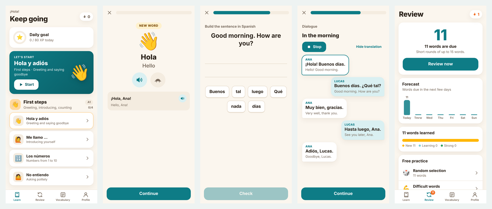
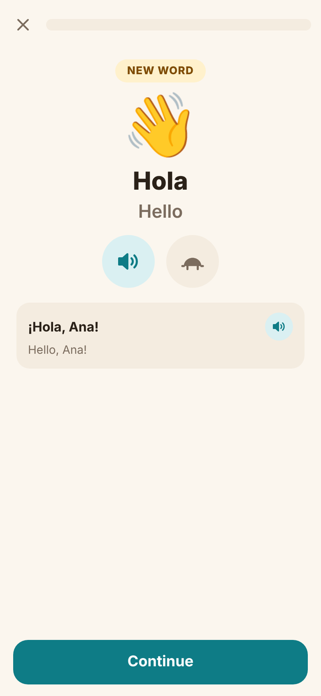
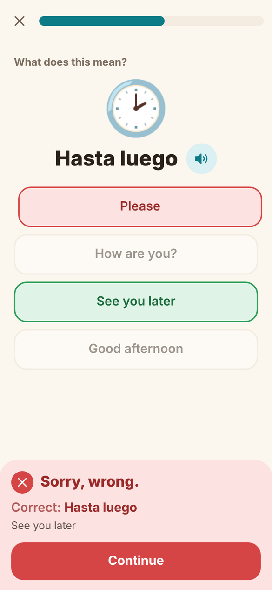
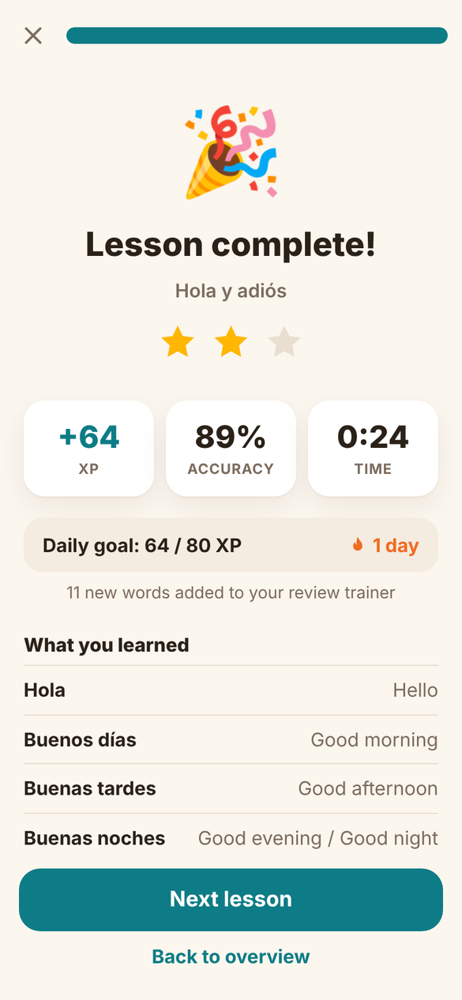
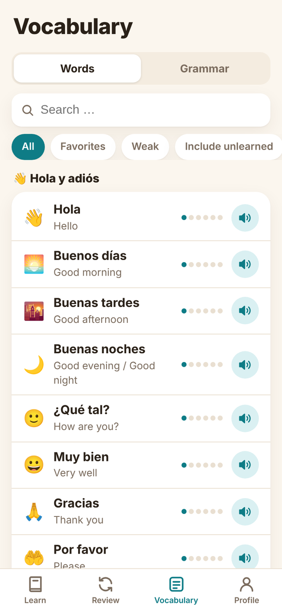
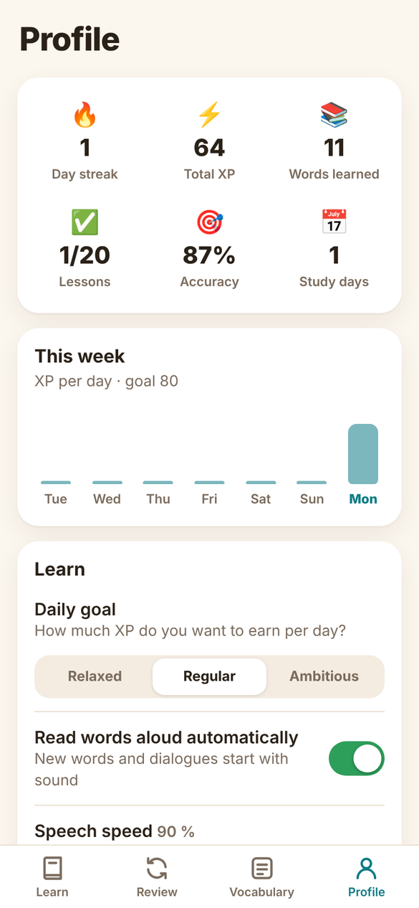

# Charla – Learn Spanish on iOS

**English** · [Deutsch](README.de.md)

[](../../actions/workflows/ci.yml)
[](LICENSE)

Charla is a free, open-source app for learning Spanish (level A1) with an English or German interface. It works offline on the iPhone and in the browser, needs no account and no third-party libraries.



> **This project was made with AI.** The code, the lessons, the texts and the app icon were developed together with Claude (Anthropic). The Spanish content was checked automatically and by sampling, but not by a teacher, so mistakes are possible. Please report them with the “Content error” issue template. Charla has no connection to any commercial language-learning service.

## Features

- **Lessons:** 5 units, 20 lessons, about 220 words and sentences. Every lesson has vocabulary, a dialogue and a grammar tip.
- **Twelve exercise types:** new word, multiple choice, picture choice, listening, matching, typing, dictation, building a sentence, fill in the gap, speaking, dialogue, fitting reply.
- **Review:** spaced repetition with the Leitner system (7 boxes from 10 minutes to 90 days). The exercise type gets harder as a word moves up.
- **Forgiving answers:** accents and small typos count as “almost right”, while ñ stays distinct.
- **Motivation:** daily goal, streak, experience points (XP) and up to three stars per lesson.
- **Vocabulary:** a list with search, favorites and “weak words”.
- **Speech:** text-to-speech and speech recognition via iOS, with adjustable voice and speed.
- **Bilingual:** the interface and all lessons are available in English and German. Choose the language on the first screen or in the profile; your progress is kept.
- **More:** dark mode, haptics, sounds, export and import of your progress.

| Lesson | Wrong answer | Result |
|---|---|---|
|  |  |  |

| Vocabulary | Profile |
|---|---|
|  |  |

## Quick start

### In the browser

Open `www/index.html`, preferably in your browser's mobile view. No build step is needed.

### On the iPhone (Mac with Xcode)

```bash
brew install xcodegen
./build_ipa.sh        # creates Charla.ipa (unsigned)
```

Alternatively: `mkdir -p Config && xcodegen generate`, open `Charla.xcodeproj` in Xcode, choose your Apple ID as the team under *Signing & Capabilities* and run it on your iPhone.

You can sign the unsigned `.ipa` with [Sideloadly](https://sideloadly.io) or [AltStore](https://altstore.io) using your Apple ID. With a free Apple ID the app runs for 7 days and then has to be signed again. Ready-made builds are available under *Releases*.

## How the app is built

```
www/             The app: HTML, CSS and JavaScript, no build step
  js/content/    Lesson data (one file per unit, German)
  js/content/en/ English translation of the lesson data
  js/i18n.js     Language layer; js/i18n/en.js holds the English interface texts
  js/engine.js   Builds the exercise sequence from a lesson
  js/exercises.js  Rendering of all exercise types
  js/srs.js      Spaced repetition (Leitner)
  js/text.js     Answer checking (accents, typos, pronunciation similarity)
  js/store.js    Progress, XP, streak
Charla/          Thin iOS shell in Swift
  WebViewController.swift   loads www/ in a WKWebView
  SpeechBridge.swift        text-to-speech and speech recognition
  StateStore.swift          progress as a JSON file
project.yml      Xcode project (XcodeGen)
tests/           Content check and end-to-end test
```

The whole interface is a web app. The Swift shell only passes iOS features through to it:

```
JavaScript ──postMessage──▶ WebViewController ──▶ SpeechBridge / StateStore / haptics
JavaScript ◀──onEvent───── WebViewController ◀── events (speakEnd, voices, listen)
```

In the browser the same features fall back to the Web Speech APIs, so almost everything can be developed and tested without a Mac.

## Languages

The Spanish course text is the same for everyone. Interface texts are written in German in the code and looked up through `tr('German text')`; `js/i18n/en.js` maps them to English. Lesson translations (word meanings, example sentences, dialogue lines, tips) live in `www/js/content/en/`. The language is chosen at startup, and switching it reloads the page. To add another language, add an interface dictionary and a content folder like the English ones and register the language code in `js/i18n.js`.

## Writing your own lessons

Add a lesson to one of the files in `www/js/content/` or create `u6.js` and include it in `www/index.html`:

```js
{
  title: 'En el café', sub: 'Im Café bestellen', emoji: '☕',
  tip: ['Tip title', 'Tip text'],
  items: [
    // [Spanish, meaning, emoji, example sentence, translation, [other accepted answers]]
    ['un café', 'ein Kaffee', '!☕', 'Un café, por favor.', 'Einen Kaffee, bitte.']
  ],
  dialogue: ['At the café', [ ['Camarero', 'Hola.', 'Hallo.'] ]]
}
```

A `!` before the emoji creates a picture-choice exercise. An empty example sentence means the word is only practised as vocabulary. Then add the English texts in the same order in `www/js/content/en/` and run `node tests/validate.js`, which checks both languages and reports missing or shifted translations.

## Tests

```bash
cd tests && npm install && npx playwright install chromium && cd ..
node tests/validate.js          # checks the content and generates thousands of random exercises (both languages)
node tests/e2e.js               # plays a lesson and a review in a mobile browser
LANGUAGE=en node tests/e2e.js   # the same in English, including a language switch
```

Both tests also run on every push in GitHub Actions. `e2e.js` saves screenshots to `tests/shots/`.

## Contributing

Bug reports, new lessons and translations are welcome. See [CONTRIBUTING.md](CONTRIBUTING.md).

## Known limitations

- Only level A1; the source languages are English and German.
- The iOS shell has had little testing. The web app has had much more.
- Voice quality depends on the iOS voices installed on the device. You can download better ones under *Settings → Accessibility → Spoken Content → Voices → Spanish*.
- Speech recognition usually needs an internet connection.

## License

[MIT](LICENSE) for code and lesson content.
